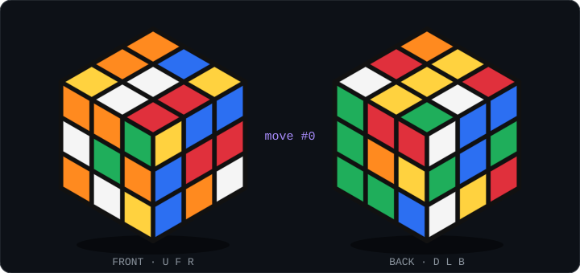

<!-- Header: generated daily by scripts/boot.py (.github/workflows/boot.yml) -->

  

  
  
  

  

---

## 🧩 Solve my Rubik's cube

I solve Rubik's cubes in my spare time — now it's **your** turn. This cube is shared by everyone who visits this page.
Click a move below, hit **Submit new issue**, and a GitHub Action turns the cube for you in ~30 seconds.

<!--CUBE_START-->

  <b>1</b> moves since the last scramble · <b>1</b> moves all‑time · solved <b>0</b>× 
  Nobody has solved it yet. 👀

| | U | R | F | D | L | B |
|:-:|:-:|:-:|:-:|:-:|:-:|:-:|
| **clockwise** | [`U`](https://github.com/AlexandreCavalcantee/AlexandreCavalcantee/issues/new?title=cube%7CU&body=Just%20hit%20%2A%2ASubmit%20new%20issue%2A%2A%20%E2%80%94%20a%20GitHub%20Action%20will%20turn%20the%20cube%20for%20you.%20%F0%9F%A7%A9) | [`R`](https://github.com/AlexandreCavalcantee/AlexandreCavalcantee/issues/new?title=cube%7CR&body=Just%20hit%20%2A%2ASubmit%20new%20issue%2A%2A%20%E2%80%94%20a%20GitHub%20Action%20will%20turn%20the%20cube%20for%20you.%20%F0%9F%A7%A9) | [`F`](https://github.com/AlexandreCavalcantee/AlexandreCavalcantee/issues/new?title=cube%7CF&body=Just%20hit%20%2A%2ASubmit%20new%20issue%2A%2A%20%E2%80%94%20a%20GitHub%20Action%20will%20turn%20the%20cube%20for%20you.%20%F0%9F%A7%A9) | [`D`](https://github.com/AlexandreCavalcantee/AlexandreCavalcantee/issues/new?title=cube%7CD&body=Just%20hit%20%2A%2ASubmit%20new%20issue%2A%2A%20%E2%80%94%20a%20GitHub%20Action%20will%20turn%20the%20cube%20for%20you.%20%F0%9F%A7%A9) | [`L`](https://github.com/AlexandreCavalcantee/AlexandreCavalcantee/issues/new?title=cube%7CL&body=Just%20hit%20%2A%2ASubmit%20new%20issue%2A%2A%20%E2%80%94%20a%20GitHub%20Action%20will%20turn%20the%20cube%20for%20you.%20%F0%9F%A7%A9) | [`B`](https://github.com/AlexandreCavalcantee/AlexandreCavalcantee/issues/new?title=cube%7CB&body=Just%20hit%20%2A%2ASubmit%20new%20issue%2A%2A%20%E2%80%94%20a%20GitHub%20Action%20will%20turn%20the%20cube%20for%20you.%20%F0%9F%A7%A9) |
| **counter‑clockwise** | [`U'`](https://github.com/AlexandreCavalcantee/AlexandreCavalcantee/issues/new?title=cube%7CU%27&body=Just%20hit%20%2A%2ASubmit%20new%20issue%2A%2A%20%E2%80%94%20a%20GitHub%20Action%20will%20turn%20the%20cube%20for%20you.%20%F0%9F%A7%A9) | [`R'`](https://github.com/AlexandreCavalcantee/AlexandreCavalcantee/issues/new?title=cube%7CR%27&body=Just%20hit%20%2A%2ASubmit%20new%20issue%2A%2A%20%E2%80%94%20a%20GitHub%20Action%20will%20turn%20the%20cube%20for%20you.%20%F0%9F%A7%A9) | [`F'`](https://github.com/AlexandreCavalcantee/AlexandreCavalcantee/issues/new?title=cube%7CF%27&body=Just%20hit%20%2A%2ASubmit%20new%20issue%2A%2A%20%E2%80%94%20a%20GitHub%20Action%20will%20turn%20the%20cube%20for%20you.%20%F0%9F%A7%A9) | [`D'`](https://github.com/AlexandreCavalcantee/AlexandreCavalcantee/issues/new?title=cube%7CD%27&body=Just%20hit%20%2A%2ASubmit%20new%20issue%2A%2A%20%E2%80%94%20a%20GitHub%20Action%20will%20turn%20the%20cube%20for%20you.%20%F0%9F%A7%A9) | [`L'`](https://github.com/AlexandreCavalcantee/AlexandreCavalcantee/issues/new?title=cube%7CL%27&body=Just%20hit%20%2A%2ASubmit%20new%20issue%2A%2A%20%E2%80%94%20a%20GitHub%20Action%20will%20turn%20the%20cube%20for%20you.%20%F0%9F%A7%A9) | [`B'`](https://github.com/AlexandreCavalcantee/AlexandreCavalcantee/issues/new?title=cube%7CB%27&body=Just%20hit%20%2A%2ASubmit%20new%20issue%2A%2A%20%E2%80%94%20a%20GitHub%20Action%20will%20turn%20the%20cube%20for%20you.%20%F0%9F%A7%A9) |
| **180°** | [`U2`](https://github.com/AlexandreCavalcantee/AlexandreCavalcantee/issues/new?title=cube%7CU2&body=Just%20hit%20%2A%2ASubmit%20new%20issue%2A%2A%20%E2%80%94%20a%20GitHub%20Action%20will%20turn%20the%20cube%20for%20you.%20%F0%9F%A7%A9) | [`R2`](https://github.com/AlexandreCavalcantee/AlexandreCavalcantee/issues/new?title=cube%7CR2&body=Just%20hit%20%2A%2ASubmit%20new%20issue%2A%2A%20%E2%80%94%20a%20GitHub%20Action%20will%20turn%20the%20cube%20for%20you.%20%F0%9F%A7%A9) | [`F2`](https://github.com/AlexandreCavalcantee/AlexandreCavalcantee/issues/new?title=cube%7CF2&body=Just%20hit%20%2A%2ASubmit%20new%20issue%2A%2A%20%E2%80%94%20a%20GitHub%20Action%20will%20turn%20the%20cube%20for%20you.%20%F0%9F%A7%A9) | [`D2`](https://github.com/AlexandreCavalcantee/AlexandreCavalcantee/issues/new?title=cube%7CD2&body=Just%20hit%20%2A%2ASubmit%20new%20issue%2A%2A%20%E2%80%94%20a%20GitHub%20Action%20will%20turn%20the%20cube%20for%20you.%20%F0%9F%A7%A9) | [`L2`](https://github.com/AlexandreCavalcantee/AlexandreCavalcantee/issues/new?title=cube%7CL2&body=Just%20hit%20%2A%2ASubmit%20new%20issue%2A%2A%20%E2%80%94%20a%20GitHub%20Action%20will%20turn%20the%20cube%20for%20you.%20%F0%9F%A7%A9) | [`B2`](https://github.com/AlexandreCavalcantee/AlexandreCavalcantee/issues/new?title=cube%7CB2&body=Just%20hit%20%2A%2ASubmit%20new%20issue%2A%2A%20%E2%80%94%20a%20GitHub%20Action%20will%20turn%20the%20cube%20for%20you.%20%F0%9F%A7%A9) |

🎲 Recent moves & top cubers

| Move | Player | When (UTC) |
|:-:|:-|:-|
| `R` | [@AlexandreCavalcantee](https://github.com/AlexandreCavalcantee) | 2026-10-19 20:56 |

| # | Player | Moves |
|:-:|:-|:-:|
| 1 | [@AlexandreCavalcantee](https://github.com/AlexandreCavalcantee) | 1 |

Current scramble: `R2 L2 U L' U L B' R' D U2 F2 B D U2 F2 L R2 U2 R B'`

<!--CUBE_END-->

---

## 🚀 Featured Projects

  
  
  
  

## 📊 Stats

  
  

  <picture>
    <source media="(prefers-color-scheme: dark)" srcset="https://raw.githubusercontent.com/AlexandreCavalcantee/AlexandreCavalcantee/output/github-contribution-grid-snake-dark.svg" />
    
  </picture>

