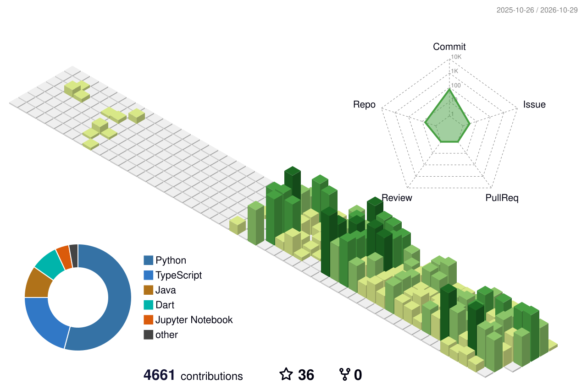

<!-- Header: generated daily by scripts/boot.py (.github/workflows/boot.yml) -->

  

  
  
  

  

---

## 🌳 Career

  

---

## 🚀 Featured Projects

  
  
  
  

## 📊 Stats

  
  

  <picture>
    <source media="(prefers-color-scheme: dark)" srcset="profile-3d-contrib/profile-night-rainbow.svg" />
    
  </picture>

